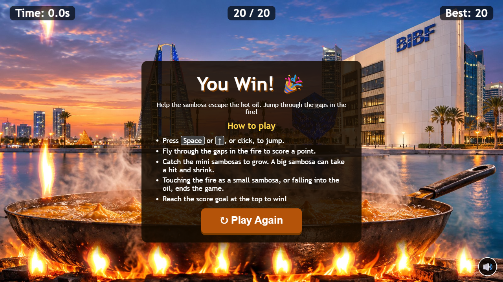
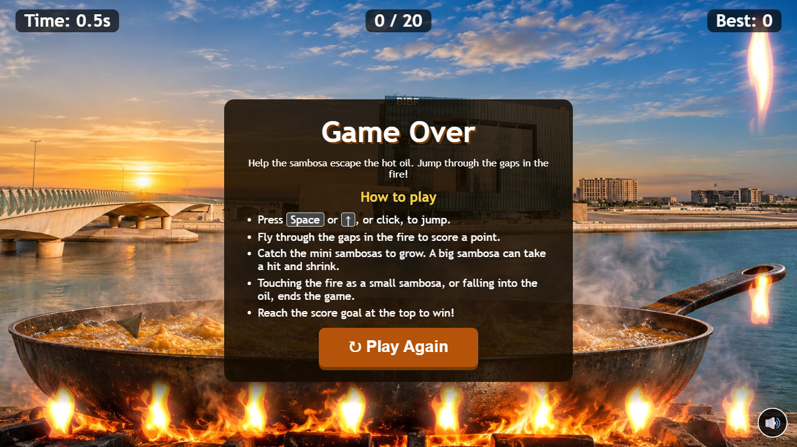

#  Sambosa Escape

## Game Link

https://hamedo0.github.io/ga-sambosa/

## Technologies Used

- HTML
- CSS
- JavaScript

## Description

A sambosa jumps through fire to escape a frying pan. The BIBF building is in the background. Score 20 points to win.

## How to Play

- Jump with the Space key, the Up Arrow key, or a click.
- Pass through the fire to score. Eat the small sambosas to grow.
- Reach 20 points to win.

## User Stories

- As a user, I should see a Play button on the start screen.
- As a user, I should be able to jump with the Space key or the Up Arrow key.
- As a user, I should be able to jump with a click.
- As a user, I should see my score go up when I pass the fire.
- As a user, I should see the sambosa grow when it eats a mini sambosa.
- As a user, I should lose when I touch the fire while I am small.
- As a user, I should see the background change every 5 points.
- As a user, I should see my best score saved after I close the page.
- As a user, I should be able to mute the sound, and the button remembers my choice.

## Screenshots

Playing screen:

Win Screen:

Game Over Screen:

## Future Enhancements

- Add a pause button.
- Add more fire patterns.
- Add a difficulty choice.
- 

## Credits

- Images: I generated from CHATGPT  
- Fire video: fire.mp4 source from Google
- Sound effects from Google
