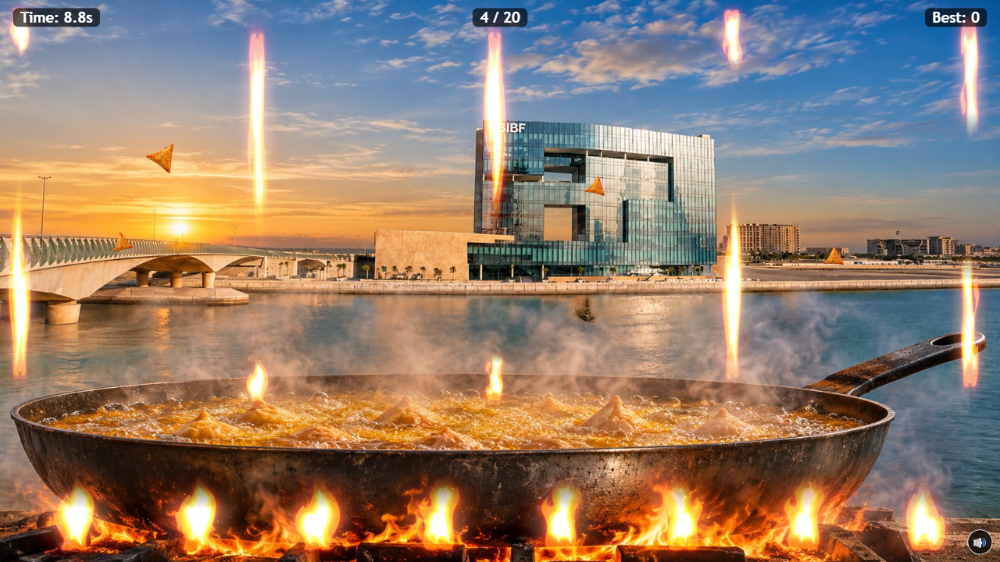

# Sambosa Escape

## Game Link

https://hamedo0.github.io/sambosa-escape/

Planning board: https://github.com/users/hamedo0/projects/2

## Technologies Used

- HTML
- CSS
- JS

## Description

A side-scrolling game. Sambosa jumps through fire to escape a frying pan. with a different images of 3 BIBF building in the background. The player should pass 20 points to win. if the player touches the fire or falls on the oil will lose.

## How to Play

- Jumping = the Space key, Up Arrow key, or a click.
- Pass through the fire to score. Eat the small sambosas to grow and size increase.
- Reach 20 points to win.

## User Stories

- As a user, I should see a Play button on the start screen.
- As a user, I should be able to jump with the Space key or the Up Arrow key.
- As a user, I should be able to jump with a click.
- As a user, I should see my score go up when I pass the fire.
- As a user, I should see the sambosa grow when it eats a mini sambosa.
- As a user, I should lose when I touch the fire while I am small.
- As a user, I should see the background change every 5 points.
- As a user, I should see my best score saved after I close the page.
- As a user, I should be able to mute the sound, and the button remembers my choice.

## Screenshots

Playing screen:

Win Screen:

Game Over Screen:

## Future Enhancements

- Add  pause button.
- Add more fire patterns.
- Add  difficulty choice.

## Credits

- Images: I generated from CHATGPT
- Fire video: https://www.vecteezy.com/video/66947130-animated-fire-glowing
- Sound effects made with Claude (AI)
